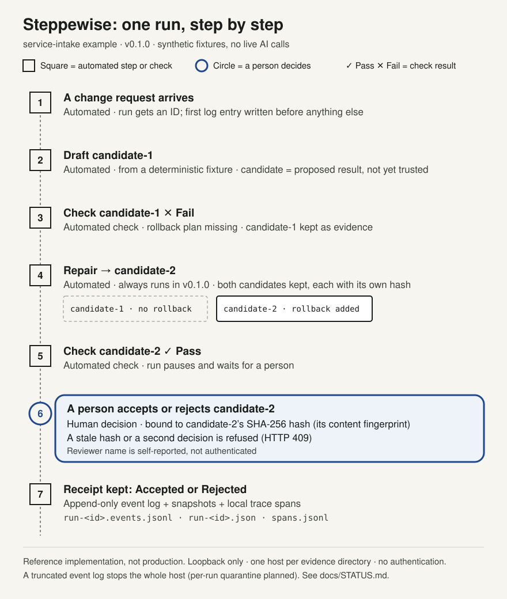

# Steppewise in two minutes

This walks through one run of the bundled `service-intake` example. In v0.1.0 every result comes from a deterministic synthetic fixture. No AI model is called.

## Three questions

- **What does it do?** Runs a fixed five-step workflow: draft a result, check it, repair it, check it again, then wait for a person.
- **What does the human decide?** Whether to accept or reject one exact, already-checked result.
- **What evidence remains?** An append-only log of every step, both versions of the result, the check outcomes, and the decision with the hash it applied to.

## Words used below

- **Candidate**: a proposed result. Not trusted until checked and decided on.
- **Verification**: an automated, rule-based check that returns pass or fail. It never approves anything.
- **Hash (SHA-256)**: a fingerprint of a candidate's exact content. Any change produces a different hash.
- **Receipt**: the durable record of a run. Entries are added, never edited.

## The run

1. **A change request arrives** *(automated)*. The run gets an ID and its first log entry is written.
2. **The workflow drafts candidate-1** *(automated)*. It comes from a fixture, not a model.
3. **Verification fails candidate-1** *(automated check, ✕ Fail)*. The rollback plan is missing. Candidate-1 is kept.
4. **Repair produces candidate-2** *(automated)*. It adds the rollback plan. Both candidates are kept with their own hashes. In v0.1.0 repair always runs; it is not triggered by the failure.
5. **Verification passes candidate-2** *(automated check, ✓ Pass)*. The run pauses and waits.
6. **A person accepts or rejects candidate-2** *(human decision)*. The decision must carry candidate-2's SHA-256 hash. A stale hash or second decision is refused with HTTP 409. The reviewer name is self-reported.
7. **The run keeps a receipt** *(automated)*. `run-<id>.events.jsonl` (step log), `run-<id>.json` (snapshot), `spans.jsonl` (local trace spans).

## Current limits

- Synthetic fixtures only; no live AI calls.
- Repair runs unconditionally; no general conditions or parallelism.
- Loopback, `dev`/`qa` only; `prod` refused at startup.
- No authenticated reviewer identity.
- One host per evidence directory (`.owner.lock`); no distributed execution.
- A truncated event log stops the whole host. Per-run quarantine is **planned, not built**.

Full boundary: [STATUS.md](STATUS.md). To try it, see the [Quick Start](../README.md#quick-start-linux-macos-and-windows).
